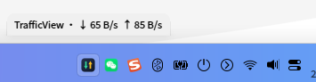

# TrafficView 1.0.1 发行说明

发布日期：2026-11-24
发行产物：`trafficview_1.0.1-1_amd64.deb`（6.2 MB）

1.0.1 是 1.0.0 之后的显示与托盘修正版，功能范围不变。


## 本版变化

- **悬浮窗可读性**：按实际背景与整体透明度计算对比度，不足时自动调整文字亮度；
  字号 12→13、字重改为 Medium、行高与内边距加大；浅色背景下增加 1px 内描边。
  皮肤的自定义背景色与背景图同样参与计算。
- **托盘 Network interface 子菜单**：`GetLayout` 现在按 `parent_id` 返回对应子树，
  子菜单显示 `Automatic` 与各网卡的单选项，不再弹出重复的根菜单。
- **静态托盘图标**：托盘固定使用应用图标（内嵌 64px PNG），不再随速率变化重绘，
  也不再每秒发送 `NewIcon`。



## 安装与升级

```bash
sudo dpkg -i trafficview_1.0.1-1_amd64.deb
```

从 1.0.0 升级会保留配置与历史数据。安装后注销重登，或手动重启托盘与悬浮窗：

```bash
pkill -f '/usr/bin/trafficview tray'
pkill -f '/usr/bin/trafficview overlay'
nohup /usr/bin/trafficview tray >/dev/null 2>&1 &
nohup /usr/bin/trafficview overlay >/dev/null 2>&1 &
```

## 系统要求

与 1.0.0 相同：Linux amd64、X11 图形会话；设置界面需要 GTK4 4.14+ 与
libadwaita 1.5+。包内不含 eBPF/AF_PACKET 特权 helper，选到这些后端时按不可用降级。

## 已知限制

- 悬浮窗仅覆盖 X11，Wayland 会话不会自动启动悬浮窗。
- 尚未验证：KDE Plasma / GNOME 的 Wayland 会话、waybar 实际渲染、XFCE 下长时间运行、
  网卡热插拔、休眠唤醒后的统计连续性、GPU 读数。
- 许可证尚未声明：仓库当前未附带 LICENSE，公开发布前必须由项目所有者确定许可证。

## 校验和

```
b247b96630232c41a03036c0f181cbd9ae65a4b18290d860c1d9ffec60706d37  trafficview_1.0.1-1_amd64.deb
```
