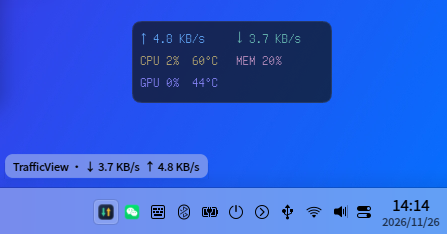

# TrafficView 1.0.2 发行说明

发布日期：2026-11-25
发行产物：`trafficview_1.0.2-1_amd64.deb`（6.2 MB）

1.0.2 是 1.0.1 之后的缺陷修复版，功能范围不变。

## 本版变化

- **修复悬浮窗拖动不跟手**：x11rb 会把无回复请求暂存在 16KB 发送缓冲中，此前拖动时
  发出的 `configure_window` 要等到下一次绘制（约 1 秒）或缓冲写满才真正发给 X server，
  表现为窗口跟不上鼠标。现在每批事件处理完立即 flush，拖动期间事件轮询间隔也从 10ms
  缩短到 1ms。
- **位置与穿透状态及时生效**：内容未变化而提前返回的绘制路径同样会 flush，避免位置预设
  或穿透切换在暂停采样时延迟应用。
- 1.0.1 的悬浮窗可读性、托盘 `Network interface` 子菜单与静态托盘图标改动保持不变。



## 安装与升级

```bash
sudo dpkg -i trafficview_1.0.2-1_amd64.deb
```

从旧版本升级会保留配置与历史数据。安装后注销重登，或手动重启托盘与悬浮窗：

```bash
pkill -f '/usr/bin/trafficview tray'
pkill -f '/usr/bin/trafficview overlay'
nohup /usr/bin/trafficview tray >/dev/null 2>&1 &
nohup /usr/bin/trafficview overlay >/dev/null 2>&1 &
```

## 系统要求

与 1.0.1 相同：Linux amd64、X11 图形会话；设置界面需要 GTK4 4.14+ 与
libadwaita 1.5+。包内不含 eBPF/AF_PACKET 特权 helper，选到这些后端时按不可用降级。

## 已知限制

- 悬浮窗仅覆盖 X11，Wayland 会话不会自动启动悬浮窗。
- 尚未验证：KDE Plasma / GNOME 的 Wayland 会话、waybar 实际渲染、XFCE 下长时间运行、
  网卡热插拔、休眠唤醒后的统计连续性、GPU 读数。
- 许可证尚未声明：仓库当前未附带 LICENSE，公开发布前必须由项目所有者确定许可证。

## 校验和

```
dd1dbc4a7cbd9e1f0bed934186de91971e683144273e76d26ae59fc583a02640  trafficview_1.0.2-1_amd64.deb
```
